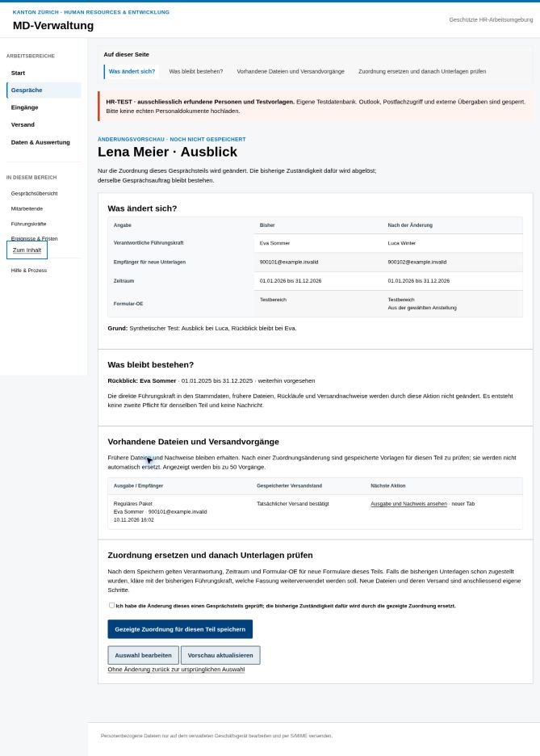
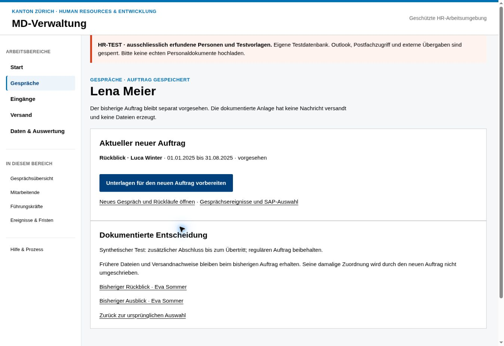
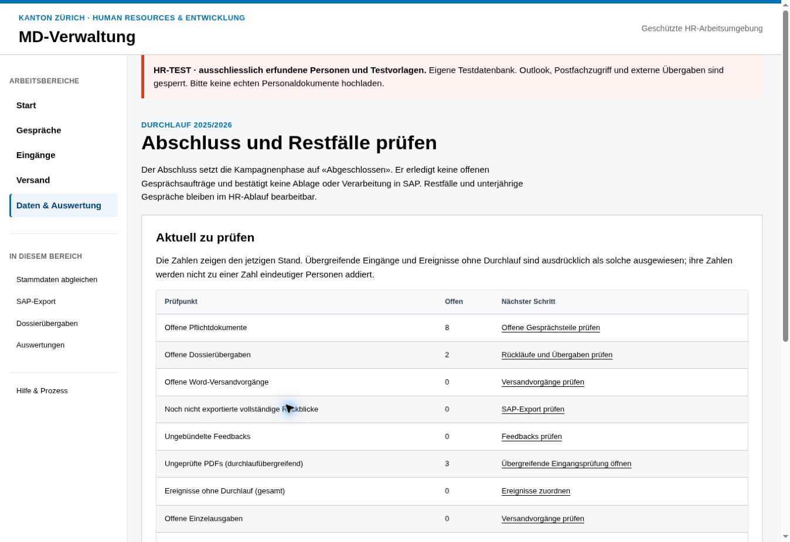
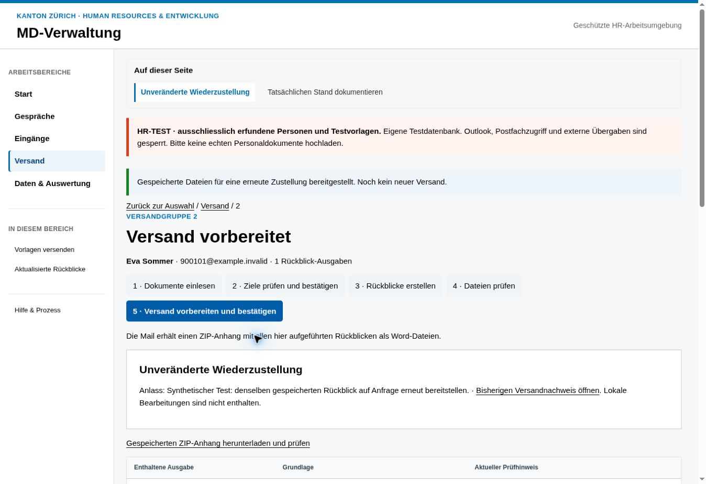

# Aufgabeneinstieg – erster integrierter Stand

Der Entwurf ist in die bestehende Flask-Anwendung übertragen. Einstieg ist `/start`;
`/arbeit` bleibt der filterbare Arbeitsvorrat, bestehende Detailadressen bleiben gültig.

## Enthalten

- Startseite mit Aufgaben für ordentlichen Durchlauf, laufende Arbeit und Änderungen.
- Navigation: Start, Gespräche, Eingänge, Versand, Daten & Auswertung. Ergänzende
  Links erscheinen im jeweiligen Bereich. Hilfe und Administration bleiben separat.
- Namen, OE, Funktion und aktuelle direkte Vorgesetzte in den Personenlisten,
  Gesprächsteilen, Zielquellen und im Arbeitsvorrat. Technische Nummern sind aufklappbar.
- Aktuelle Vorgesetzte stammen aus gültigen aktiven Zuordnungen je Anstellung.
  Mehrfachanstellungen werden nicht auf eine beliebige erste Zuordnung reduziert.
  Die Verantwortung für einen Gesprächsteil wird separat aus der bestehenden
  Fachzuordnung angezeigt; ein Wechsel der direkten Vorgesetzten verändert sie nicht.
- Gesprächsübersicht mit Namenssuche, Verantwortungssuche, Sortierung nach
  Mitarbeitenden oder verantwortlicher Führungskraft, Arbeitsstand, Überfälligkeit,
  Jahr, OE und serverseitiger Seitennavigation.
- Zielübernahme mit bestehendem Ablauf von Prüfung über Dateierstellung und
  Dateiprüfung bis zum dokumentierten Versand im neuen Anwendungsrahmen.
- Kompaktere Formulare und Tabellen; mobile Navigation bei schmalen Ansichten.

## Bewusst noch bestehende Bedienwege

Fristen und Erinnerungen lassen sich jetzt direkt aus einer seitenübergreifenden
Gesprächsauswahl vorbereiten. Die bisherigen Durchlaufansichten bleiben erreichbar.
Der genaue Umfang und die Schutzmechanismen sind unter «Zweite Etappe» beschrieben.

Die Verwaltung von Formularversionen und erwarteten Steuerelementen bleibt V01
im Aufgaben- und UX-Konzept. Die einzelnen alten Fachformulare sind noch nicht
vollständig neu gestaltet. Es gibt keine neue Versandpflicht für Intranet-Rückläufe,
keine Änderung der fachlichen Rücklaufzuordnung und keine Datenmigration.

## Prüfung

Gezielte Integrationstests prüfen insbesondere aktuelle gegenüber historischer
Gesprächsverantwortung, Mehrfachanstellungen, Namenssuche, Status-/Fristfilter und
den Rückweg in die aufrufende Liste. Die bestehenden Tests zu Zielübernahme,
Rücklauf, Word-Erstellung, Versand und Berechtigungen bleiben massgeblich.
Browserprüfung mit isolierter synthetischer Datenbank: Startseite, Zielübersicht
und Suche nach verantwortlicher Führungskraft. Keine echten HR-Daten und keine
Outlook-Aktionen während der Prüfung.

## Zweite Etappe: gemeinsame Gesprächsauswahl und Aktionen

- Checkboxen dieser Seite werden beim Seitenwechsel oder beim Öffnen der
  Aktionsvorschau gespeichert. «Alle gefilterten Gesprächsteile auswählen» hält
  genau die aktuelle Treffermenge fest. Später neu hinzukommende Treffer werden
  nicht automatisch ergänzt. Ein neuer Filterlauf beginnt eine neue Auswahl.
- Die Auswahl ist an die Browsersitzung gebunden, revisioniert und 24 Stunden
  gültig. Eine zweite Registerkarte kann eine veraltete Auswahl nicht überschreiben.
- Die Vorschau zeigt Namen, betroffene Teile, Verantwortung und alte/neue Frist
  beziehungsweise Empfänger und vollständige Nachrichten. Berücksichtigte und
  ausgeschlossene Teile werden getrennt gezählt und mit Gründen angezeigt.
  Vorschautabellen zeigen höchstens 50 Einträge pro Seite.
- Änderungen an Frist, Zustand, Zuständigkeit, Empfänger oder ungeklärten Eingängen
  machen eine Vorschau ungültig. Vor der Ausführung wird die unveränderte Grundlage
  nochmals unter der bestehenden Prozesssperre geprüft.
- Fristen werden für genau die geprüfte zulässige Teilmenge geändert. Änderung und
  Protokoll je bestehender Pflicht werden gemeinsam in einer Datenbanktransaktion
  gespeichert. Die reguläre Durchlauffrist bleibt unverändert. Im bestehenden
  Fristprotokoll wird der Geltungsbereich `case` je betroffener Pflicht verwendet.
- Erinnerungen verwenden dieselben Fachregeln und denselben Outlook-Adapter wie
  die bisherigen Ansichten, eingeschränkt auf die konkrete Auswahl. Gruppierung
  nach Durchlauf und tatsächlicher Gesprächsverantwortung. Ein fehlender erfasster
  Vorlagenversand verhindert die Anerkennung eines Rücklaufs nicht.
- Bereits eingegangene oder abgeschlossene Unterlagen werden nicht erneut als
  fehlend angefordert. Offene Scanpflichten behalten ihre spezifische Anforderung.
  Ungeklärte Eingänge und offene Outlook-Vorgänge bleiben fachliche Sperren.
- Vor Outlook wird ein dauerhafter Vorgang reserviert und mit der Aktion verknüpft.
  Bekannte Ergebnisse werden je Empfänger festgehalten. Bei Teilfehlern zeigt das
  Ergebnis die tatsächlich dokumentierten Entwürfe. Ein unklarer Ausgang führt
  zu keiner automatischen Wiederholung. Der tatsächliche Versand wird separat
  geprüft und bestätigt; die Erstellung eines Entwurfs ist kein Versandnachweis.
- Migration `006_part_actions` ergänzt Auswahlen, Vorschauen und die Zuordnung zu
  Erinnerungsvorgängen. Bestehende Pflichten und fachliche Status werden weder
  kopiert noch in eine zweite Aufgabenverwaltung überführt.

Prüfung: 365 Python-Tests und elf JavaScript-Tests erfolgreich. Die neuen Tests
prüfen unter anderem Seitenwechsel, festgehaltene Treffermengen, Sitzungsgrenzen,
veraltete Revisionen, CSRF, atomare Friständerungen, Rückläufe ohne Versand,
getrennte Verantwortung, späte Eingänge, Outlook-Fehler und Teilergebnisse.
Browserprüfung mit erfundenen Personen: Checkboxen, Auswahlanzeige, Fristvorschau,
Ausführung und Ergebnisrückmeldung sowie Erinnerungsausschlüsse. Der echte
Outlook-Zugriff ist in der Browser-Testumgebung gesperrt.

## Dritte Etappe: Eingänge und Prüfung nach Aufgaben

Die bisherige lange Eingangsseite ist im regulären HR-Modus in drei Ansichten
aufgeteilt: «Dokumente prüfen», «Nachweise & Ablage» und «Postfach». Ihre offenen
Zähler gelten über alle Jahre und Durchläufe. Die jeweilige Liste bleibt
serverseitig paginiert. Feedback-Bündel und alte Zielquellen sind direkt verlinkt.

Die Dokumentliste lässt sich nach Name oder Datei durchsuchen. Sie zeigt Name,
OE und aktuelle direkte Führungskraft; ausgelesene Angaben bleiben ausdrücklich
als ungeprüfte Vorschläge gekennzeichnet. Übernommene Rückläufe führen zur
bestehenden Nachweis-/Ablagebearbeitung, historische Ziele zur Zielbearbeitung.
Daten und Zeitpunkte werden im Eingangsbereich in Schweizer Schreibweise gezeigt.

In der PDF-Prüfung werden Person und Anstellung über eine Namenssuche gewählt.
Die Beschriftung enthält OE, Funktion und aktuelle direkte Führungskraft;
technische Nummern stehen separat. Der Server leitet Personal- und
Anstellungsnummer aus der gewählten Anstellung ab. Manipulierte versteckte
Nummern können diese Auswahl nicht übersteuern. Eine leere oder ungültige Auswahl
kann nicht bestätigt werden. Mehrfachanstellungen ohne eindeutige Grundlage
werden nicht automatisch auf eine beliebige erste Anstellung reduziert. Die
Gesprächsvorschläge nennen die tatsächlich zugeordnete Gesprächsverantwortung.

Ein Rücklauf aus einer Intranet-Vorlage benötigt keinen erfassten Vorlagenversand.
Die bestehenden fachlichen Prüfungen der Person, Anstellung, Zeiträume und Inhalte
bleiben erhalten. Es wird kein Versand nachgetragen und keine neue Zuordnung
allein aus einem Dateinamen abgeleitet. Fehlt ein passender Gesprächsvorgang,
bleibt die bestehende manuelle Klärung notwendig.

«Kein MD-Dokument» bleibt eine eigene reversible Aktion ohne Pflichtfelder für
MD-Daten. Auch der Mailanhang zeigt den Ausschluss ausdrücklich. Die übrigen
Anhänge und das Mailanliegen werden dadurch nicht automatisch abgeschlossen.
Bei gesperrten Erinnerungen sind die ungeprüften PDF-Dateien konkret verlinkt;
nach ihrer Bearbeitung ist die Erinnerungsvorschau erneut zu prüfen.

Der Postfachbereich zeigt standardmässig alle offenen Mailanliegen einschliesslich
Fehlern. Einstellungen und Verarbeitungserklärungen sind dort gebündelt.
«Prüfung erledigt» verschiebt weiterhin keine Mail. Mailaktionen erhalten einen
lokalen gefilterten Rückweg, externe Rücksprungziele werden verworfen. Alte
Postfach-Lesezeichen und Suchparameter bleiben erreichbar.

Validierung: zwölf zusätzliche Integrationstests zu getrennten Ansichten,
Namenssuche, Seitennavigation, Mehrfachanstellungen, kanonischer Personenauswahl,
Ausschluss und Originalerhalt, Rückläufen ohne Versand, offenen Mailfehlern sowie
sicheren Rückwegen. Browserprüfung der Ansichten, Namenssuche, PDF-Personenwahl
und alten Postfach-Lesezeichen mit ausschliesslich erfundenen Testpersonen.
Keine Postfachprüfung, Nachricht oder externe Dossierübergabe im Browser ausgelöst.

## Vierte Etappe: Versand fortsetzen und Nachweise erhalten

«Versand» öffnet eine gemeinsame, serverseitig paginierte Übersicht über reguläre
Pakete, Einzelausgaben und Rückblicke mit nachgereichten Zielen. Gesucht wird nach
Namen, Empfänger oder OE; Versandstand, Art und Rückblickjahr sind filterbar.
Die aktuelle Versandadresse ist vor der Outlook-Übergabe sichtbar, danach die
zum Vorgang gespeicherte Adresse. Einzelausgaben verwenden die tatsächlich im
Manifest gespeicherte Gesprächszuständigkeit statt der ursprünglichen Führungslinie.

Für ein reguläres Paket gibt es eine eigene Detailansicht: Dateien herunterladen,
enthaltene Personen und Gesprächsteile prüfen, personalisierte Nachricht ansehen
oder bearbeiten, genau diesen Outlook-Entwurf erstellen und anschliessend den
wirklichen Versand dokumentieren. Die Prüfaussage benennt Dateien, Empfänger und
Nachricht ausdrücklich. Sie führt keinen zusätzlichen dauerhaften Freigabestatus
ein. Dateiliste und Versandübersicht haben getrennte Seitennavigation.

Fehlgeschlagene und unterbrochene Outlook-Vorgänge haben konkrete Klärungsaktionen.
Die Detailansicht verschickt keine Nachricht direkt. Die bestehende Sammelbearbeitung
bleibt für den regulären Durchlauf erreichbar. Die Nachrichtenvorschau berücksichtigt
auch Führungskräfte, die nur für einen neu zugewiesenen Gesprächsteil zuständig sind.

Eine erneut erzeugte Ausgabe setzt einen früher bestätigten Versand nicht zurück.
Die neue Ausgabe verlinkt den bisherigen Nachweis; der Verlauf enthält auch
abgelöste und ausdrücklich verworfene Dateien. «Offen» bezeichnet die gespeicherten
Versandvorgänge. Spätere Stammdatenänderungen sind weiterhin im Durchlauf zu prüfen;
ein früherer Versand ist keine Bestätigung dieser späteren Änderungen.

Die neue Oberfläche nutzt die bestehenden Versand-, Datei- und Quellenprüfungen
sowie Outlook-Sperren. Vor jeder Entwurfserstellung werden diese erneut ausgeführt.
Unbekannte Aktionen und fehlende explizite Prüfaussagen werden abgewiesen. Neue
POST-Aktionen sind mit CSRF geschützt. Gefilterte Rückwege bleiben bei Paket-,
Einzel- und Zielversand erhalten; externe Rücksprungziele werden verworfen.

Validierung: 395 Python-Tests und elf JavaScript-Tests erfolgreich. Zwölf neue
Integrationstests zu den drei Versandarten, Namen und
abweichender Gesprächszuständigkeit, Zustandsübergängen, erhaltenem Versandnachweis,
veralteten Quelldaten, manipulierten Dateien, abgelösten Ausgaben, Seitenwechseln,
CSRF, Sandbox-Sperre und Rückwegen. Browserprüfung der Namenssuche, Versandart,
Paketansicht, enthaltenen Personen, bearbeiteten personalisierten Vorschau und
des gefilterten Rückwegs mit ausschliesslich erfundenen Personen. Keine Nachricht
oder externe Übergabe im Browser ausgelöst.

## Fünfte Etappe: Durchlaufstart und Stammdatenfolgen verbinden

«Durchlauf beginnen oder fortsetzen» führt zu `/durchlauf`. Die Ansicht verbindet
Stammdatenprüfung, Gesprächsaufträge/Fristen und Vorlagenversand. Vorhandene Jahre
werden zur Fortsetzung angeboten. Eine erneute Anlage desselben Jahres öffnet den
bestehenden Durchlauf; es entsteht kein zweiter Auftrag. Neue Durchläufe verwenden
den zuletzt übernommenen Datenstand. Hat er sich seit dem Öffnen geändert, ist die
Grundlage neu zu prüfen. Die vorhandene Fachfunktion legt Aufträge und Fristen an;
dabei entstehen keine Word-Dateien oder Versandnachweise.

Die Übersicht zeigt vorhandene Gesprächsteile und reguläre Ausgaben getrennt.
Zählungen gelten nicht als inhaltliche Freigabe und ein früherer Versand bestätigt
keine späteren Datenänderungen. Die Gesprächsliste lässt sich für das Rückblickjahr
öffnen. Die SAP-Zähler beziehen sich ausdrücklich auf alle Abgleiche; der gewählte
Durchlauf ist ein Arbeitskontext, keine Beschränkung der allgemeinen Datenübernahme.

Der SAP-Abgleich hat getrennte Einstiege für «Datenprüfung offen» und «Daten
übernommen – Gesprächsfolgen offen». Zähler und Filter folgen den bestehenden
Abgleicheinträgen und berücksichtigen abgelöste Vorschauen nicht als offene Arbeit.
In Vorschau, Einzelauswahl und Vergleich werden OE, Funktion und die Namen der
Führungskräfte gezeigt; Nummern stehen in den Zuordnungsdetails. Im neuen Export
enthaltene Namen werden als solche verwendet. Unbekannte Zuordnungen werden nicht
geraten. Fehlende Exportpersonen werden mit ihrem bisherigen Kontext bezeichnet.

Die Personendetailansicht führt von den geänderten Angaben über Gesprächsbedarf
und Zuständigkeit zum dokumentierten Prüfergebnis. Geeignete Personendaten können
von dort einzeln zur bestehenden Übernahmeprüfung gewählt werden. Gesprächsfolgen
zeigen die betroffenen Personen und Jahre sowie die tatsächlich zugewiesene
Verantwortung je Teil. Vorlagenaktualisierung, Versandprüfung und zusätzliche
unterjährige Aufträge sind direkt erreichbar. Datenübernahme allein ändert oder
schliesst diese Gesprächsaufträge nicht und stellt keine Unterlagen zu.

Der Abschluss einer Folgeprüfung benennt ausdrücklich die fachlich zu prüfenden
Wirkungen und verlangt ein konkretes Ergebnis. Er dokumentiert diese Prüfung;
er führt weder Zuweisung noch Erstellung oder Versand automatisch aus. Die
vorhandene Kontext-/Revisionsprüfung verhindert einen Abschluss auf veraltetem
Daten- oder Gesprächsstand. Durchlaufkontext und gefilterter Rückweg bleiben bei
Einzelauswahl, Übernahme und weiterer Bearbeitung erhalten. Nach Anlage eines
zusätzlichen Ereignisses kann zur aufrufenden SAP-Folgeprüfung zurückgekehrt
werden; diese bleibt dabei offen. Externe Rücksprungziele werden verworfen.

Validierung: vollständige Python-Suite erfolgreich (405 Tests im Gesamtlauf),
zwölf gezielte Integrationstests im abschliessenden Lauf sowie elf JavaScript-Tests.
Geprüft wurden unter anderem unveränderte Leseansichten, Anlage/Wiederaufnahme,
veralteter Importstand, kanonische Fortschrittszähler, abgelöste Einträge,
Namenskontext, Einzelübernahme, erhaltene Gesprächsverantwortung, konkrete
Abschlussvermerke und sichere Rückwege. Browserprüfung mit erfundenen Personen:
Durchlaufeinstieg, Übernahme eines Führungs-/OE-Wechsels, weiterhin offene
Gesprächsfolgen und Anschluss an die unterjährige Erfassung. Keine echte Nachricht,
Postfachverarbeitung oder externe Dossierübergabe ausgelöst.

Noch offen im umfassenden Aufgabenmodell: unveränderte Wiederzustellung,
geführtes Ersetzen bestehender Gesprächsaufträge und die weitere Vereinheitlichung
der übrigen Arbeitswege. Die Vorlagen-/Steuerelementverwaltung bleibt V01.

## Sechste Etappe: gespeicherte Unterlagen unverändert nochmals zustellen

Aus einer als versandt bestätigten regulären Ausgabe lässt sich das ganze Paket
oder der gespeicherte Formularumfang einer einzelnen Person erneut bereitstellen.
Die Links stehen bei der Ausgabe und in der personenbezogenen Formularansicht.
Die Vorschau nennt Empfänger, enthaltene Personen, konkrete Dateien und Beilagen.
Bei einer Gesamtzustellung kann direkt zur Prüfung einer einzelnen Person
gewechselt werden. Es gibt keine frei eingegebene Empfängeradresse.

Das vollständige Paket wird bytegleich kopiert. Bei der einzelnen Person werden
nur ihre vorhandenen Word-Dateien und die gemeinsamen Beilagen aus dem Original
in ein neues Versand-ZIP übernommen; die Bytes jedes Dokuments bleiben gleich.
Es wird keine Word-Vorlage neu befüllt, auch nicht während der Versandprüfung.
Lokale Bearbeitungen der Führungskraft sind ausdrücklich nicht enthalten und
werden durch die Wiederzustellung nicht automatisch ersetzt.

Neue Versandvorgänge nutzen die vorhandenen Paket- bzw. Einzelausgaberecords mit
Herkunftsverweis und Anlass im Manifest. Die frühere Ausgabe und ihr Versandnachweis
bleiben bestehen. Es entstehen keine neuen Gesprächsaufträge oder Pflichten und
keine neue Datenbankmigration. Wiederholte Vorbereitung desselben Auftrags findet
seinen Vorgang wieder, auch nach einem bereits bestätigten Versand. Bereits offene
Wiederzustellungen werden zur Fortsetzung angeboten.

Nur die aktuelle, nicht verworfene und bereits versandte Ausgangsausgabe ist
geeignet. Die aktuelle Grundlage wird vor Vorbereitung und erneut vor Outlook
geprüft. Bei einer Person wird ihr gespeicherter Grundlagenumfang verglichen;
eine sachfremde Änderung bei einer anderen Person blockiert sie nicht pauschal.
Geänderte eigene Namen, Ziele, Zuständigkeit oder Vorlagen, veränderte Dateien und
neuere Ausgaben führen zur konkreten Klärung. Ältere Personenausgaben ohne
prüfbaren gespeicherten Grundlagenstand werden nicht als unverändert bestätigt.

Vorhandene Rückläufe, abgeschlossene oder nicht mehr vorgesehene Teile sowie
möglicherweise passende ungeprüfte Eingänge verhindern die leere Wiederzustellung.
Die Eingangsprüfung wird für Rückblick und Ausblick getrennt angewandt. Konkrete
PDF-Dateien und Rückläufe sind verlinkt. Ein unbekannter Eingang bleibt ungeklärt;
er wird keiner Person als belegter Rücklauf zugeschrieben. Ein ausdrücklich
fachfremd ausgeschlossener Eingang blockiert die Wiederzustellung nicht mehr.

Die vorhandenen Outlook-Sperren, Verschlüsselungsprüfung, Entwurfs-/Fehlerklärung
und tatsächliche Versandbestätigung gelten auch für diese Vorgänge. Neue Eingänge
zwischen Vorbereitung und Outlook verhindern einen veralteten Versand. Die
Vorbereitungsvorschau ist signiert, zeitlich begrenzt, an die Sitzung und den
geprüften Umfang gebunden und mit CSRF geschützt. Sie löst keinen Outlook-Aufruf
aus. Der Anlass bleibt intern; die Nachricht nennt die unveränderte Wiederzustellung.

Validierung: Gesamtlauf mit 421 Python-Tests und 70 Subtests sowie elf
JavaScript-Tests erfolgreich; vierzehn zusätzliche Integrationstests decken
Bytegleichheit, exakt begrenzte Personenauswahl, Originalerhalt, Wiederholungen,
Versandzustände, geänderte Grundlagen, späte und fachfremde Eingänge, Dateimanipulation,
Sitzungsgrenzen, CSRF und übergreifende Outlook-Sperren ab. Der abschliessende
gezielte Lauf ist ebenfalls erfolgreich. Die Tests verbieten das erneute Rendern
von Word-Dateien während Vorbereitung und Zustellung ausdrücklich per Mock.
Browserprüfung mit erfundenen Personen: gesperrte Gesamtzustellung, Auswahl einer
zulässigen Person, Dateiumfang, Beilagen, Anlass und Übergang in den eigenen
vorbereiteten Versandvorgang. Keine echte Nachricht ausgelöst.

Umfang dieser Etappe: gespeicherte reguläre Pakete und personenbezogene Auswahl
daraus. Eigenständige Zielnachreichungs-Versandgruppen und frühere Einzelausgaben
sind noch keine auswählbaren Quellen dieser unveränderten Wiederzustellung.
Das geführte Ersetzen bestehender Gesprächsaufträge und die übrigen noch offenen
Bedienwege bleiben weitere Arbeit. V01 bleibt wie vereinbart später.

## Etappe 7: Bestehende Zuständigkeit je Gesprächsteil geführt ändern

Der Einstieg «Gesprächsauftrag ändern / Verlauf» zeigt Namen, OE und die direkte
Führungskraft sowie die davon gegebenenfalls abweichende Zuständigkeit für den
gewählten Rückblick oder Ausblick. Zeitraum, verantwortliche Führungskraft und
Formular-OE werden zuerst in einer Änderungsvorschau gegenübergestellt. Ein
Grund ist erforderlich; die Vorschau verändert noch keine fachlichen Daten.

Die Vorschau benennt ausdrücklich den unveränderten anderen Gesprächsteil und
zeigt vorhandene Dateien, gespeicherte Versandnachweise, konkrete Rückläufe und
ungeklärte Eingänge. Offene Outlook- und Erinnerungsvorgänge sowie vorhandene
Rückläufe verlangen zuerst eine Klärung. Die verlinkte Klärung öffnet einen neuen
Tab; «Vorschau aktualisieren» erhält die eingegebenen Angaben. Ein unbekannter
Eingang wird weiterhin nicht als nachgewiesener Rücklauf einer Person behandelt.

Die geprüfte Übernahme ersetzt ausschliesslich die Zuständigkeit innerhalb des
bestehenden Gesprächsteils. Sie erzeugt keinen zweiten Auftrag und erledigt nicht
den ganzen MD. Frühere Dateien, Nachrichten und Nachweise bleiben bestehen.
Danach führt ein eigener Schritt zu neuen Unterlagen, mit ausschliesslich dem
gewählten Teil vorausgewählt. Neue zusätzliche Gespräche bleiben ein gesonderter
Vorgang und schliessen frühere Aufträge nicht automatisch.

Die signierte Vorschau ist eine Stunde gültig, sitzungsgebunden und CSRF-geschützt.
Die geführte Übernahme prüft ihren vollständigen Grundlagenstand unter derselben
Sperre wie Outlook und innerhalb einer Schreibtransaktion erneut. Neue Eingänge,
geänderte Stammdaten oder parallele Zuordnungsänderungen verlangen eine erneute
Prüfung. Dieselbe Bestätigung bleibt auch bei Wiederholung idempotent. Im Verlauf
werden die Namen zum Änderungszeitpunkt gespeichert; ältere Einträge mit nur einer
Personalnummer kennzeichnen die ersatzweise verwendeten heutigen Stammdaten.

Validierung: zwölf neue Integrationstests sowie der angepasste isolierte
Bedienungstest prüfen Vorschau ohne fachliche Schreibzugriffe, Teilbegrenzung,
Originalerhalt, tatsächliche Formularerzeugung, Wiederholungen, parallele Änderungen,
späte Eingänge, offene Versand-/Erinnerungsvorgänge, Namen im Verlauf,
Sitzungsgrenzen und signierte Angaben. Browserprüfung mit erfundenen Personen:
Ausblick Eva Sommer → Luca Winter, Rückblick bleibt bei Eva; anschliessend ist
nur der Ausblick zur Formularerstellung ausgewählt. Kein echter Outlook-Aufruf.

Offen bleiben insbesondere neue zusätzliche Gesprächsaufträge mit gesonderter
Erledigung eines alten Auftrags, weitere Wiederzustellungsquellen und die noch
nicht vereinheitlichten Bedienwege etwa für SAP-Export und Abschluss. V01 bleibt
wie vereinbart später.

## Etappe 8: Zusätzliche Gespräche und bisherige Aufträge ausdrücklich entscheiden

Aus einem vorhandenen Gesprächsteil führt «Zusätzliches / unterjähriges Gespräch
erfassen» zu einem eigenen Ablauf für dieselbe Person, Anstellung und denselben
Jahresbezug. Namen, OE, direkte Führungskraft und bisherige Gesprächsverantwortung
bleiben sichtbar. Für eine reine Korrektur verweist der Ablauf auf die Änderung
der vorhandenen Teilzuständigkeit.

Gesprächsart, neue Teile, Zeitraum, Fristen, Führungskraft und Formular-OE werden
zuerst geprüft. Der gewählte Zeitraum gilt – wie im bestehenden unterjährigen
Ereignismodell – für alle neuen Teile. Bei unterschiedlichen Zeiträumen sind
separate Aufträge erforderlich. Eine ausdrückliche Auswahl entscheidet zwischen
Beibehalten des bisherigen Auftrags und vollständiger Ersetzung. Eine teilweise
Ersetzung ist hier nicht vorgesehen. Die neue Auswahl muss alle noch vorgesehenen
Teile des alten Auftrags umfassen, damit dieser als erübrigt markiert werden kann.

Vorhandene Rückläufe und ungeklärte Eingänge sowie offene Outlook- und
Erinnerungsvorgänge blockieren die vollständige Ersetzung. Die konkreten Nachweise
und Vorgänge sind aus der Vorschau erreichbar. Das ausdrückliche Hinzufügen eines
weiteren Auftrags bleibt möglich; es verändert den bisherigen Auftrag nicht.
Eine bereits bestehende entsprechende Gesprächsanlage wird angezeigt und verlinkt.

Die Übernahme legt den neuen Auftrag und die gegebenenfalls gewählte Aufhebung des
gesamten alten Auftrags in einer gemeinsamen Transaktion an. Eine Ausnahme rollt
beide Änderungen zurück. Die bestehende interne Ereigniserstellung kann dafür ihr
Commit dem aufrufenden Ablauf überlassen; ihr bisheriges Standardverhalten bleibt
erhalten. Die Vorschau ist signiert, eine Stunde gültig, sitzungsgebunden und
CSRF-geschützt. Der geprüfte Stand wird unter der vorhandenen Outlook-Sperre erneut
verglichen. Wiederholte Bestätigung findet denselben neuen Auftrag wieder.

Bei vollständiger Ersetzung werden die alten Pflichten als nicht mehr angefordert
geführt; das alte Ereignis ist aufgehoben und sein Fall inaktiv. Seine bisherigen
Dateien, Zuordnungen und Versandnachweise bleiben erhalten. Noch vorbereitete alte
Pakete können nicht anschliessend als unveränderter aktueller Stand versandt
werden. Die Entscheidung einschliesslich Grund, Namen und Verweis auf den neuen
Auftrag bleibt beim alten Auftrag sichtbar. Der neue Gesprächsbezug wird nicht als
neue direkte Führungslinie aktiviert. Eine SAP-führende Auswahl wird nicht auf den
neuen Rückblick übertragen; sie bleibt ein eigener fachlicher Schritt.

Das Ergebnis zeigt den aktuellen neuen Auftrag und führt zu seinen vorausgewählten
Formularteilen. Die Anlage selbst erzeugt weder Word-Dateien noch Nachrichten.
Der ursprüngliche Versand wird nicht zurückgerufen.

Validierung: Gesamtlauf mit 441 Python-Tests und 70 Subtests erfolgreich; der
abschliessende gezielte Lauf umfasst zusätzlich Tests zum blockierten Versand alter
vorbereiteter Pakete, zu SAP-Auswahl und Verlauf sowie offenen Erinnerungen.
Geprüft werden ausserdem echte Formularerzeugung, Erhalt des alten Auftrags,
vollständige Ersetzung, Rückabwicklung, Wiederholungen, Dubletten, parallele
Änderungen, späte Rückläufe und Sitzungs-/CSRF-Grenzen. Browserprüfung mit erfundenen
Personen: zusätzlicher Abschluss bei Übertritt anlegen, bisherigen regulären
Auftrag beibehalten und die Formularvorbereitung für den neuen Rückblick öffnen.
Kein echter Outlook-Aufruf.

Umfang: geführte Ergänzung oder vollständige Ersetzung aus einem vorhandenen
Auftrag im selben Jahresbezug. Die Erfassung ohne vorhandenen Ausgangsauftrag ist
weiterhin über die bestehende Ereigniserfassung möglich. Noch offen bleiben unter
anderem weitere Wiederzustellungsquellen und die Vereinheitlichung von SAP-Export
und Abschluss; die Formularsteuerelement-Verwaltung V01 bleibt wie vereinbart später.

## Etappe 9: SAP-Batches prüfen und Kampagnenabschluss dokumentieren

Der SAP-Einstieg führt vor einer neuen Datei zur Personen- und Exportvorschau.
Namen, OE, heutige direkte Führungskraft und tatsächliche Rückblickzuständigkeit
stehen vor den technischen IDs. Die Liste zeigt neue Exportzeilen, offene
Gesprächsfälle, bereits bereitgestellte Ereignisse und konkreten Klärungsbedarf.
Suche, Standfilter und Seiten mit 25 Zeilen begrenzen ausdrücklich nur die Anzeige,
nicht den Umfang des Batches. Beim Batch bleiben die bisherigen fachlichen
Exportregeln erhalten: vollständiger Gesprächsfall, durchgeführter Rückblick,
massgebendes SAP-Ereignis, numerische Zuordnung, Datum und Bewertung sowie auf das
Rückblickjahr und Ein-/Austritt begrenzter Zeitraum. Inaktive und aufgehobene
Aufträge sind ausdrücklich ausgeschlossen.

Die Vorschau verwendet denselben Exportkollektor wie die tatsächliche Erstellung.
Bei fehlender SAP-Auswahl oder ungültigen Exportangaben ist zuerst die konkrete
Klärung erforderlich; es entsteht kein stillschweigender Teilbatch. Nach der
Erstellung zeigt eine eigene Ansicht die gespeicherten Datensätze und bietet den
Download derselben Datei an. Erstellung und Download bestätigen keine Verarbeitung
in SAP. Namen in der Batchansicht stammen ausdrücklich aus heutigen Stammdaten,
Exportwerte und technische Zuordnung aus dem gespeicherten Nachweis. Eine geänderte
Dokumentfassung nach Export führt zur separaten Korrekturklärung, nicht zum
automatischen erneuten Export. Gespeicherte Dateien werden vor erneutem Download
gegen ihre Prüfsumme geprüft.

Die geführte Batch-Erstellung ist signiert, sitzungsgebunden, eine Stunde gültig
und CSRF-geschützt. Sie vergleicht den gesamten Prüfstand unter Outlook-Sperre und
Schreibtransaktion erneut. Wiederholte Bestätigung findet denselben Batch über den
in derselben Transaktion gespeicherten Auditverweis wieder. Bestehende interne
Exportaufrufe bleiben kompatibel; alte UI-Erstellungsaktionen führen im neuen
HR-Ablauf zunächst zur Prüfung.

Der Kampagnenabschluss zeigt aktuelle Restaufgaben mit jeweiligen Klärungswegen,
einschliesslich Einzelausgaben, Zielnachreichungs-Versand und ungeklärter
Erinnerungsvorgänge. Übergreifende PDFs, ungeklärte Postfachnachrichten und Ereignisse ohne Durchlauf
sind als übergreifend bezeichnet. Der Link zu den offenen Gesprächsteilen filtert nach dem
gesamten Durchlauf, damit auch die Ausblicke des Folgejahrs enthalten sind; dieser
Filter bleibt bei Seitennavigation und Sammelauswahl erhalten.

Der Abschluss erledigt keine Gesprächspflichten und löst keine externe Ablage oder
SAP-Verarbeitung aus. Restfälle bleiben im HR-Ablauf bearbeitbar. Bei verbleibenden
Aufgaben sind Begründung und verantwortliche Person erforderlich. Die tatsächliche
Dossier-/SAP-Verarbeitung wird ausserhalb der App geprüft. Eine signierte,
sitzungsgebundene Abschlussgrundlage wird vor der Übernahme innerhalb derselben
Sperre und Transaktion erneut verglichen – auch bei Änderungen mit gleicher
Restfallzahl. Eine Aktualisierung erhält Begründung und Verantwortlichkeit.
Klärungslinks öffnen neue Tabs. Der damalige Abschlussstand und die damalige
Restfallverantwortung sind vom aktuellen Arbeitsstand getrennt sichtbar.
Eine wiederholte alte Bestätigung schliesst einen inzwischen wieder geöffneten
Durchlauf nicht erneut und behauptet keinen neuen Abschluss.

Validierung: Integrationstests vergleichen Vorschau und tatsächliche Exportzeilen,
prüfen echte Excel-Erstellung, wiederholte Erstellung und bytegleichen Download,
veraltete Grundlagen, Dateiänderungen, fehlende SAP-Auswahl, inaktive Ereignisse,
Restfallbegründung, gleichzahlige Änderungen, Wiederöffnung, Sitzungs-/CSRF-Grenzen,
Weiterleitung alter UI-Aktionen und den Durchlauffilter bei Sammelauswahl.
Browserprüfung ausschliesslich mit erfundenen Personen: Einstieg, Prüfung eines
exportierbaren Rückblicks, Batch-Erstellung und gespeicherte Personenauswahl sowie
Abschlussübersicht mit konkreten Restaufgaben. Kein SAP-Zugriff, keine echte
Nachricht und kein produktiver Abschluss.

Noch offen bleiben weitere Quellen für unveränderte Wiederzustellungen und die
abschliessende Prüfung der zusammengeführten Bedienwege. Die Verwaltung der
Formularsteuerelemente V01 bleibt wie vereinbart eine spätere Etappe.

## Etappe 10: Wiederzustellung aus Einzelausgaben und Zielnachreichungen

Bestätigte personenbezogene Einzelausgaben und bestätigte Zielnachreichungs-Gruppen
bieten jetzt einen direkten Einstieg zur unveränderten Wiederzustellung. Die
Vorschau nennt Empfänger, Namen, Gesprächsteile und den gesamten gespeicherten
Dateiumfang. Der komplette ZIP-Anhang wird bytegleich kopiert. Auch unmittelbar
vor Outlook wird weder Word gerendert noch das Zielnachreichungs-ZIP neu aufgebaut.
Lokale Ergänzungen der Führungskraft bleiben ausdrücklich ausserhalb dieses Anhangs.

Die Vorbereitung nutzt vorhandene Einzelausgabe- bzw. Zielnachreichungs-Versanddaten
und speichert Herkunft, Anlass und Dateinachweis im vorhandenen Manifest bzw.
Ereignisverlauf. Der ursprüngliche Versandnachweis und die Gesprächspflichten
bleiben erhalten. Bestehende vorbereitete Vorgänge werden wiedergefunden.
Die geführte Vorbereitung ist signiert, sitzungsgebunden, eine Stunde gültig und
CSRF-geschützt. Sie prüft den aktuellen Stand unter der gemeinsamen Outlook-Sperre
und innerhalb einer Schreibtransaktion erneut. Ein abgebrochener Wiederzustellungs-
Vorgang verhindert nach tatsächlicher Outlook-Klärung keine neue ausdrückliche
Anforderung; dieselbe alte Bestätigung erzeugt weiterhin keinen zweiten Vorgang.

Neue Einzelausgaben speichern einen lesend ermittelten, auf ihre tatsächlichen
Gesprächsteile begrenzten Grundlagenstand. Eine reine Ausblick-Ausgabe wird dadurch
nicht von einer Änderung am anderen Rückblickteil abhängig. Für ältere Einzelausgaben
ohne diesen belastbaren Nachweis wird keine unveränderte Grundlage behauptet; der
konkrete Hinweis verweist auf aktuelle Formulare. Zielnachreichungs-Gruppen verwenden
die bereits vorhandenen geprüften Ausgabegrundlagen und den Nachweis des tatsächlich
an Outlook übergebenen gemeinsamen ZIP-Anhangs.

Geänderte Zuständigkeiten, Ziele, Stammdaten und Vorlagen, spätere überlappende
Ausgaben, bereits abgeschlossene oder nicht mehr vorgesehene Teile sowie mögliche
oder bestätigte Rückläufe verlangen zuerst eine Klärung. Die gemeinsame Sperre
berücksichtigt dabei auch die eigene Zielnachreichungs-Wiederzustellung korrekt,
ohne andere offene Outlook-Vorgänge zu übergehen. Vor Outlook werden der kopierte
Anhang, sein Umfang und sein Empfänger erneut geprüft. Konkrete Eingangslinks bleiben
auch dann sichtbar, wenn schon eine Wiederzustellung vorbereitet war und erst danach
ein Rücklauf eingegangen ist; dies gilt ebenfalls für die reguläre Wiederzustellung.

Bei der Bedienprüfung fielen unterschiedlich formatierte UTC- und lokale Versandzeiten
auf. Die gemeinsame Zeitanzeige verwendet für zeitzonenbehaftete Zeitangaben jetzt
Schweizer Ortszeit; neue Word-Versandzeitpunkte werden mit Mikrosekunden gespeichert.
Gleichzeitige ältere Einzelausgaben werden zusätzlich anhand ihrer Reihenfolge
unterschieden. Der dokumentierte Zeitpunkt selbst wird nicht umgeschrieben.

Validierung: Gesamtlauf mit 469 Python-Tests und 70 Subtests sowie elf JavaScript-Tests
erfolgreich. Der abschliessende gezielte Lauf mit 13 Tests ist ebenfalls erfolgreich.
Zusätzliche Integrationstests verbieten Word-Rendering und Neuaufbau
des gemeinsamen ZIPs ausdrücklich per Mock. Sie prüfen Bytegleichheit, tatsächliche
Outlook-Anhangübergabe an den isolierten Adapter, Erhalt der ursprünglichen Pflichten
und Versandstände, Wiederholungen, Abbruch und erneute Anforderung, neue überlappende
Ausgaben, geänderte Empfänger, späte Eingänge, Dateiänderungen, Quellen ohne
Grundlagenstand, unabhängige Gesprächsteile, Sitzungs-/CSRF-Grenzen, Download und
konkrete Klärungslinks. Die Zeitanzeige hat einen eigenen Regressionstest.
Browserprüfung mit erfundenen Personen: bestätigte Zielnachreichungs-Gruppe öffnen,
Wiederzustellung prüfen und vorbereiten; danach dasselbe für eine reine Ausblick-
Einzelausgabe. Beide enden im vorhandenen Versandablauf mit erhaltenem Ausgangsnachweis.
Kein echter Versand ausgelöst.

### Zusammenhängende Prüfung des Aufgabenbestands

Die bisherigen Integrationstests laufen gemeinsam auf dem Stand dieser Etappe.
Der synthetische Browserbestand wurde über den tatsächlichen Ziel-Parser, die
Quellenübernahme, Rückblick-Erzeugung, Dateifreigabe und Gruppenbildung bis zum
mit FakeOutlook dokumentierten Ausgangsversand aufgebaut. Die neue Wiederzustellung
setzt genau an diesem Bestand an. Dieser Nachweis ersetzt keine Produktionsprüfung
mit echten Outlook-Nachrichten oder dem externen SAP-/Dossierprozess.

| Aufgaben | Stand der Nutzerführung | Verbleibende Grenze |
|---|---|---|
| U01, U09 | Durchlaufvorbereitung und Stammdatenfolgen geführt | Fachliche Zuordnungsentscheidungen bleiben ausdrücklich bei HR |
| U02, U11, U14 | Eingangsprüfung und Rückläufe mit konkreten Folgeschritten | Externe Ablage wird nicht allein aus einer lokalen Datei abgeleitet |
| U03 | Reguläre Pakete, Einzelausgaben und Zielnachreichungs-Gruppen als Quellen | Alte Einzelausgaben ohne prüfbaren Grundlagenstand werden zur Neuerstellung geführt; neue Quellen werden jeweils vollständig übernommen |
| U04, U10 | Teilzuständigkeit ändern oder zusätzlichen Auftrag anlegen; vollständige Ersetzung ausdrücklich entscheiden | Teilweise Ersetzung eines ganzen alten Auftrags bleibt eine gesonderte Klärung |
| U05, U07, U08 | Seitenübergreifende Auswahl, Fristen und Erinnerungen mit Vorschau | Versand wird erst nach tatsächlicher Outlook-Prüfung bestätigt |
| U06 | Quellenübernahme bis zum eigenen Rückblick-Versand und Wiederzustellung verbunden | Bestehende Rückläufe führen zur Korrekturklärung statt zu neuen leeren Vorlagen |
| U12, U15 | SAP-Vorschau, gespeicherter Batch und dokumentierter Abschluss | Keine automatische Bestätigung externer Verarbeitung |
| U13, U16 | Bisherige Feedback-Bündelung und Auswertung bleiben erreichbar | Diese Fachansichten sind noch nicht vollständig neu gestaltet |
| V01 | Wie vereinbart später | Verwaltung erwarteter Formularsteuerelemente und Formularversionen |

Die technisch integrierten Bedienwege und der synthetische Volumentest sind geprüft.
Die abschliessende fachliche Bedienabnahme mit Tastatur, schmalem Fenster und
Vergrösserung über sämtliche Fachformulare bleibt vor einer vollständigen
UX-Abnahme ausdrücklich offen. Die Änderung ist weiterhin ein Entwurfsstand,
keine Behauptung, alle Fachansichten seien bereits vollständig umgestaltet.

